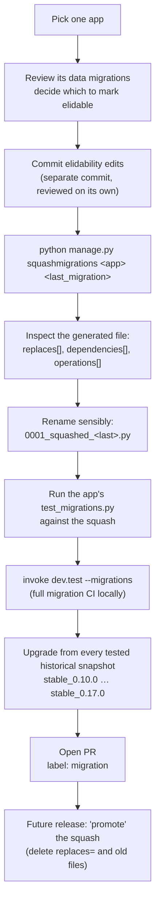

# Squashing Migrations — A Developer's Guide

!!! info "Who this is for"
    Anyone — including volunteers who have never worked on InvenTree or on a Django project — who is about to squash, rewrite or review migrations. It is intentionally verbose. If you already know Django migrations inside-out, skip to [Per-app inventory](#per-app-inventory) and the [Squashing workflow](#squashing-workflow).

At the time of writing, InvenTree ships **663** committed migrations across 13 backend apps, **61** of which contain `RunPython` or `RunSQL` data steps. Applying them on a fresh install takes several minutes; on a large production database an in-place upgrade can take much longer. Squashing is the cheapest, safest way to cut both numbers without changing behaviour.

This page explains:

- How Django migrations work (very briefly, for non-Django contributors).
- What "squashing" does and does not do.
- Every InvenTree backend app: its models, its migration history, its data migrations, and what to watch out for when squashing it.
- Exact step-by-step workflows — local, CI, PR — with the commands you need to run.
- How to keep the squash correct for *fresh installs* **and** for *upgrading installations*.
- A checklist for the PR author and the reviewer.

---

## 1. A five-minute primer on Django migrations

A Django **migration** is a Python file describing a set of changes to the database schema (or data) for one app. Migrations live in `src/backend/InvenTree/<app>/migrations/`, numbered `0001_…`, `0002_…`, and so on. Each migration file declares:

```python
class Migration(migrations.Migration):
    dependencies = [
        ('part', '0153_bomitem_piece_count_bomitem_piece_size'),
        ('stock', '0127_alter_stockitemtestresult_options'),
    ]
    operations = [
        migrations.AddField(...),
        migrations.RunPython(forward, reverse),
        ...
    ]
```

- `dependencies` — the migrations that must already have been applied (both within the same app, and in other apps). Django uses this to build a global **migration graph** and topologically order everything at `migrate` time.
- `operations` — schema changes (`AddField`, `AlterField`, `RemoveField`, `CreateModel`, …) and/or data changes (`RunPython`, `RunSQL`). Data operations are arbitrary Python/SQL — anything from "copy column A to column B" to "rebuild an MPTT tree".
- The **order of operations is significant** within a migration and between migrations, because later operations assume earlier ones have been applied.

Django tracks which migrations have been applied to a given database in the `django_migrations` table. On `migrate`, Django compares what is applied with what is on disk and runs the missing ones in dependency order.

### Why there are so many

Every time someone changes a model — adds a field, renames one, changes a `choices` list, adjusts `help_text` — Django produces a new migration. Over six years of development, that adds up. Some migrations are **data migrations** (`RunPython`/`RunSQL`) that transform existing rows; these cannot be mechanically regenerated and must be preserved or rewritten.

### What `migrate --fake` does (and why not to use it as a shortcut)

`python manage.py migrate --fake <migration>` marks a migration as applied **without running it**. Handy for recovering broken migration state, catastrophic if used to "skip" a slow data migration in production — the data transformation never happens, and weeks later you discover subtly corrupted rows. Never recommend `--fake` to users as a performance workaround.

---

## 2. What squashing actually is

`python manage.py squashmigrations <app> <to_migration>` produces a single new file in the same folder — for example `part/migrations/0001_squashed_0153_bomitem_piece_count.py` — whose `operations` list is the *optimised* concatenation of all operations from `0001` through `0153`.

The crucial line in the squashed file is:

```python
class Migration(migrations.Migration):
    replaces = [
        ('part', '0001_initial'),
        ('part', '0002_auto_…'),
        ...
        ('part', '0153_bomitem_piece_count_bomitem_piece_size'),
    ]
    dependencies = [ ... ]
    operations = [ ... ]     # the merged, optimised list
```

The `replaces = [...]` line tells Django: *"This file is equivalent to all of these older migrations combined."* With that line in place, two things happen at the same time:

| Database state | What Django does at `migrate` time |
|---|---|
| **Fresh database** (no rows in `django_migrations`) | Apply the one squashed migration. Skip the individual files even if they're still on disk. |
| **Database already at some point between `0001` and `0153`** | Continue applying the remaining individual files. When it finally catches up past `0153`, record the squash as applied. |

That is the whole trick. As long as the `replaces` list is present, **both worlds keep working**: new installs get the fast path, existing deployments keep their familiar step-by-step path.

### Promoting a squash

Once every supported upgrade source has caught up (i.e. every environment you support has already applied the replaced migrations), you can:

1. Delete the `replaces = [...]` line from the squashed migration.
2. Delete the old individual migration files.
3. Renumber the squash to `0001_initial` (optional but clean).

Only then does the file count actually shrink on disk and does the migration graph become permanently smaller. **Until you promote**, the old files must remain committed.

### What squashing is **not**

- Not a rewrite. `squashmigrations` runs an optimiser that collapses trivially redundant operations (e.g. `AddField` followed by `RemoveField` of the same field) but otherwise preserves everything. It does not remove `RunPython` steps — those are always kept unless explicitly marked elidable (see §4).
- Not a way to escape bad data migrations. If the original data migration was slow, the squash will still be slow for installs that haven't run it yet.
- Not a substitute for squash-per-release discipline. Squashing once and then accumulating another 300 migrations puts you right back where you started.

---

## 3. Why InvenTree needs this

### The numbers, today

| App | Migrations | With `RunPython` / `RunSQL` | Notes |
|---|---:|---:|---|
| **part** | 154 | 15 | Largest history. Contains `Part`, `PartCategory` (MPTT), `BomItem`, `PartPricing`, `PartStocktake`, parameter templates, revisions/variants. |
| **stock** | 128 | 12 | `StockItem`, `StockLocation` (MPTT), tracking, test results. 1.5.0 removed MPTT from `StockItem` — heavy data migration in that series. |
| **order** | 123 | 8 | Purchase / Sales / Return / Transfer orders, line items, shipments, allocations. |
| **company** | 80 | 7 | `Company`, `Contact`, `Address`, `ManufacturerPart`, `SupplierPart`. |
| **build** | 59 | 6 | `Build`, `BuildLine`, `BuildItem`. Already contains one historical squash (`0021…0026`). |
| **common** | 49 | 7 | Settings, Attachment, Parameter/ParameterTemplate, NotificationMessage, WebhookEndpoint, Email. |
| **report** | 32 | 2 | `ReportTemplate`, `LabelTemplate`, `ReportSnippet`, `ReportAsset`. |
| **users** | 16 | 4 | `ApiToken`, `RuleSet`, `Owner`, `UserProfile`. |
| **plugin** | 11 | 0 | `PluginConfig`, `PluginSetting`, `PluginUserSetting`. |
| **importer** | 8 | 0 | `DataImportSession`, `DataImportColumnMap`, `DataImportRow`. |
| **machine** | 2 | 0 | `MachineConfig`, `MachineSetting`. |
| **users** | 16 | 4 | (see above) |
| **InvenTree** | 1 | 0 | No own models — cross-app fixtures only. |
| **data_exporter** | 0 | 0 | No models. |
| **Total** | **663** | **61** | |

### What a squash buys us

- **Fresh installs / CI / devcontainers**: one SQL batch per app instead of 154. This is the main win new contributors feel — start-up time drops dramatically.
- **File count**: the number of files in `git diff`, code navigation, and reviewer cognitive load.
- **Migration graph**: Django builds a `DiGraph` at startup from every migration file. A smaller graph means faster `migrate --check`, faster `showmigrations`, and faster autoreload during development.
- **Easier reviews**: when model changes collapse into one migration, reviewers can see the end state of a release in one file.

### What it does *not* buy us

- It does not speed up **in-place upgrades** of databases that haven't caught up. Those still run each individual migration; the squash is only chosen when none of the replaced migrations are applied.
- It does not speed up the heavy data migrations themselves. Rewriting those (bulk SQL, chunked updates, deferred rebuilds) is a separate project — see [Fast-path tactics for large data migrations](#fast-path-tactics-for-large-data-migrations).

---

## 4. Non-obvious rules you must internalise before squashing

1. **`RunPython` and `RunSQL` operations are preserved.** The optimiser only reasons about schema operations. If a data step is a no-op for new installs, you must **mark it `elidable=True`** in the original migration *before* running `squashmigrations`, otherwise the squash will keep it and new installs will still pay the cost.
   ```python
   migrations.RunPython(forward, reverse, elidable=True)
   ```
2. **Elidable steps are removed only on a fresh database.** They still run for any install that hasn't yet applied them. Getting elidability wrong therefore causes a **silent data-correctness bug on fresh installs**, not on upgrades. Review with this in mind.
3. **Cross-app dependencies matter.** Every migration declares dependencies on other apps; a squash must preserve the *earliest* dependency on each other app that any of the replaced migrations had. `squashmigrations` handles this automatically, but reviewers should double-check the `dependencies = [...]` list.
4. **One squash per app at a time.** Squashing multiple apps in the same PR makes the dependency graph harder to reason about and bisecting a regression harder. Even if you squash them all in the same release, do them in separate commits.
5. **Do not delete the old migration files in the same PR as the squash.** The `replaces = [...]` list requires them to exist. Deletion is a *future* PR — the "promotion" step — after a policy decision.
6. **Squashes are not bypassable.** Once merged, every developer (and CI) must have them. There is no way to "opt out" of the squashed file without breaking the graph.
7. **Migrations that refer to old models that no longer exist in `models.py`** still need to resolve — Django rebuilds a fake model state from the migration chain. If a squash accidentally `CreateModel`s a class that was later fully removed, that's fine. If it references a class that isn't re-created, the graph breaks.

---

## 5. Per-app inventory

The column "Squash priority" reflects how much a squash helps *and* how risky it is — not just the size of the history.

| App | Priority | Difficulty | Notes |
|---|---|---|---|
| part | **high** | high | 154 files, 15 data migrations, MPTT hierarchy on `PartCategory`. |
| stock | **high** | high | 128 files, 12 data, MPTT on `StockLocation`, recent MPTT removal on `StockItem`. |
| order | **high** | medium | 123 files, 8 data. Mostly additive; line/extra-line model introductions are the tricky part. |
| company | medium | low | 80 files, 7 data. Largest data migration: address normalisation (0064). |
| build | medium | low | 59 files, 6 data. Already has one old squash (2020) — good precedent. |
| common | medium | medium | 49 files, 7 data. Settings model touched often. |
| report | medium | low | 32 files, 2 data. Template-upload-path migrations. |
| users | medium | medium | 16 files, 4 data. MFA migration is fiddly. |
| plugin | low | trivial | 11 files, 0 data. Pure schema. |
| importer | low | trivial | 8 files, 0 data. |
| machine | skip | — | Only 2 files. Squashing buys nothing. |
| InvenTree | skip | — | Single file. |
| data_exporter | skip | — | No migrations. |

### 5.1 `part`

**Models** (`part/models/`): `PartCategory` *(MPTT tree)*, `PartCategoryParameterTemplate`, `PartCategoryStar`, `Part` *(revision/variant hierarchy)*, `PartPricing`, `PartStocktake`, `PartStar`, `PartTestTemplate`, `BomItem`, `BomItemSubstitute`, `PartRelated`.

**Key facts for squashing**

- `PartCategory` inherits from `InvenTreeTree`, which extends `mptt.MPTTModel`. The MPTT fields (`lft`, `rght`, `tree_id`, `level`, `parent`) are added via MPTT's own migration on the app's initial migration. Squashing must keep these fields in the initial `CreateModel` exactly as MPTT expects. **Do not hand-edit MPTT fields after squashing.**
- `Part` is the most heavily modified model in the project. Many of the 154 migrations are `AlterField` choice/help-text changes. The squash optimiser collapses most of these into the final `CreateModel`, which is where most of the win comes from.
- Data migrations to inspect:
  `0034`, `0056`, `0083`, `0102`, `0109`, `0111`, `0116`, `0121`, `0129`, `0138`, and later. Many were one-off normalisations (name/IPN cleanup, variant tree reshuffles). Each is a candidate for `elidable=True` **if** it is purely a "fix historical data" operation — i.e. it has no effect on a blank DB.
- Cross-app dependencies: `part` migrations reference `stock`, `company`, `build`, `order`, `common`, `users`, `taggit`. The squash should carry the **earliest** of each.
- Tags: `Part` uses `InvenTreeTagsMixin` (django-taggit). Taggit installs its own migrations; our migrations have FK references. Keep the dependency on the correct taggit migration.

**Watch out for**

- `PartCategory` category tree will be rebuilt by MPTT's `CreateModel`; no runtime `rebuild()` is needed on a fresh install, but be aware that **any data migration that moves categories around must stay in the chain** — MPTT nodes are integrity-checked on save.
- Part variant/template relations (`variant_of`) created in later migrations. Ensure the FK with `related_name='variants'` is present in the squashed `CreateModel`, not only added later.

### 5.2 `stock`

**Models** (`stock/models.py`): `StockLocationType`, `StockLocation` *(MPTT)*, `StockItem`, `StockItemTracking`, `StockItemTestResult`.

**Key facts**

- `StockItem` was an MPTT tree until release 1.5.0 (PR #12360). The migration that removes the MPTT columns is **expensive on large databases** and must not be elided. After squash, fresh installs get a `StockItem` with no MPTT columns; installs pre-1.5 still execute the drop.
- `StockLocation` remains MPTT — same rules as `PartCategory`.
- Data migrations: `0061`, `0064`, `0069`, `0071`, `0081`, `0085`, `0094`, `0096`, `0106`, `0108`, `0119` (MPTT removal), and others. The ones normalising historical status codes (`0081`, `0094`) are prime elision candidates; the MPTT removal is not.
- Cross-app deps: `part`, `order`, `build`, `company`, `common`, `users`, `taggit`, `django_q` (the background-task library is referenced by one legacy migration).

**Watch out for**

- `StockItem.serial_int` / `serial` population migrations — they backfill a numeric sort key from the text serial. On fresh installs there is nothing to backfill; mark elidable.
- Ownership migrations (`owner` FK introduced mid-way) — keep in place.

### 5.3 `order`

**Models**: `Order` (abstract), `PurchaseOrder`, `SalesOrder`, `ReturnOrder`, `TransferOrder` (all concrete); `OrderLineItem` (abstract) and its four concrete subclasses; `OrderExtraLine` (abstract) and its four subclasses; `SalesOrderShipment`, `SalesOrderAllocation`, `ReturnOrderLineItem`, `TransferOrderLineItem`, `TransferOrderAllocation`.

**Key facts**

- The model *shape* has changed several times: Return orders and Transfer orders were added in separate waves; extra lines were introduced as separate models in `0064_purchaseorderextraline_salesorderextraline` (a data migration that copies lines).
- Reference-field migrations (`reference_int`) for sorting — copy-to-integer backfill — are prime elision candidates.
- Discount fields (1.5.0), piece-count (latest) — purely additive, no concerns.
- Cross-app deps: `part`, `stock`, `company`, `build`, `common`, `users`.

**Watch out for**

- The base `Order` abstract class is not its own model — don't look for an `Order` `CreateModel` in the squash. You will find four concrete models. That's correct.
- `TotalPriceMixin` adds monetary fields; ensure the squash carries the final currency choices (which have been broadened over time).

### 5.4 `company`

**Models**: `Company` (customer/supplier/manufacturer via flags), `Contact`, `Address`, `ManufacturerPart`, `SupplierPart`.

**Key facts**

- `0064_move_address_field_to_address_model` — **non-trivial data migration**: copies the old single-string `Company.address` field into the new `Address` model with a FK back. Must stay; do **not** mark elidable (fresh installs have no old `Company.address` to copy, but the guard is inside the migration and cheap — safe to keep as-is rather than risk eliding it).
- `SupplierPart` pricing migrations (`0036_supplierpart_update_2`) migrate legacy price strings to `django-money` — may be elidable on fresh installs; read the function carefully.
- Deps: `part`, `stock`, `order`, `build`, `common`, `taggit`.

**Watch out for**

- `Address` has ordering constraints and a `primary` flag — migrations that set `primary=True` on the first address per company must remain; mark them elidable only if they explicitly short-circuit on empty tables.

### 5.5 `build`

**Models**: `Build`, `BuildLine`, `BuildItem`.

**Key facts**

- Already contains `0021_auto_20201020_0908_squashed_0026_auto_20201023_1228.py`, produced with Django 3.0.7 back in 2020. Good precedent: same pattern, `replaces=[…]`, schema-only optimisation.
- Data migrations: `0018_build_reference` (reference backfill — elidable), `0032`, `0036`, `0044`, `0046`, `0050` (various status / line-item normalisations — evaluate each).
- Has a dedicated test: `build/test_migrations.py` that uses `django_test_migrations` to exercise the reference migration specifically. **A squash must keep that test green** — see §7.

### 5.6 `common`

**Models**: `MetaMixin`, `UpdatedUserMixin` (abstract), `InvenTreeSetting`, `InvenTreeUserSetting`, `PriceBreak`, `WebhookEndpoint`, `WebhookMessage`, `NotificationEntry`, `NotificationMessage`, `NewsFeedEntry`, `NotesImage`, `CustomUnit`, `Attachment`, `InvenTreeCustomUserStateModel`, `SelectionList`, `SelectionListEntry`, `ParameterTemplate`, `Parameter`, `BarcodeScanResult`, `DataOutput`, `EmailMessage`, `EmailThread`, `ProjectCode`.

**Key facts**

- `InvenTreeSetting` / `InvenTreeUserSetting` are touched on almost every release to adjust `choices` or `help_text` — these are the bulk of the history and collapse cleanly under `squashmigrations`.
- `0010_migrate_currency_setting` — a one-off normalisation; elidable.
- `0028_colortheme_user_obj` — moves legacy colour-theme rows onto the user object; elidable if it's a no-op for empty tables.
- `Attachment` was moved into `common` from per-app tables; the migration that did that is in app-specific histories, not in `common` itself.
- Deps: `part`, `stock`, `order`, `build`, `company`, `plugin`, `users`.

### 5.7 `report`

**Models**: `ReportTemplateBase` (abstract), `ReportTemplate`, `LabelTemplate`, `ReportSnippet`, `ReportAsset`.

**Key facts**

- Templates were unified from two separate systems (legacy `LabelTemplate` + `ReportTemplate`) — that's where the two data migrations live (`0023`, `0026`).
- Upload paths changed — the squash needs the final `upload_to` values.

### 5.8 `users`

**Models**: `ApiToken`, `RuleSet`, `Owner`, `UserProfile`.

**Key facts**

- `0013_migrate_mfa_20240408_1659` — migrates legacy MFA tokens to `django-mfa`. **Keep; do not elide** unless you can prove the target tables are new in the squashed schema.
- `0016_remove_legacy_user_sessions_table` — drops a table that was never created on fresh installs. This is the classic example of an operation that must be conditional (see the migration source). When squashed, make sure the `RunSQL` has an `IF EXISTS` guard or is marked elidable for fresh DBs.
- External deps: `mfa`, `otp_static`, `otp_totp` — keep dependency entries.

### 5.9 `plugin`, `importer`, `machine`

Small histories, zero or few data migrations. Low-priority, low-risk squashes. Good candidates for a volunteer's first squash PR.

---

## 6. Squashing workflow

The short version:



### Step by step

#### 1. Pick an app

Start small — `plugin`, `importer`, or `machine` — to build confidence. Do **not** start with `part` or `stock`. Open a tracking issue naming the app so nobody else starts a parallel squash.

#### 2. Mark data migrations `elidable=True` where safe

Open the app's data migrations (grep for `RunPython` / `RunSQL`) one by one. For each, ask:

> "If this ran on a database with zero user rows, would it have any effect?"

- If "no effect" — *and* the forward function short-circuits safely on empty querysets (`if not Model.objects.exists(): return`) — add `elidable=True`:
  ```python
  migrations.RunPython(forward, migrations.RunPython.noop, elidable=True),
  ```
- If "yes effect" (e.g. it creates a default `RuleSet`, seeds a first entry, adds a needed row) — **do not** elide.
- If uncertain — leave it. Non-elided data migrations are merely slow; incorrectly elided ones cause missing data.

Commit elidability edits in their own commit with a clear rationale per migration in the commit message. Reviewers evaluate each one individually.

#### 3. Run `squashmigrations`

```bash
source env/bin/activate   # or your virtualenv
cd src/backend/InvenTree
python manage.py squashmigrations <app_label> <last_migration_name>
```

For example:

```bash
python manage.py squashmigrations part 0153_bomitem_piece_count_bomitem_piece_size
```

Django:

- Reads every migration in the range, builds the in-memory project state, and asks the optimiser to merge operations.
- Writes `src/backend/InvenTree/<app>/migrations/0001_squashed_<last>.py`.
- Preserves all non-elidable `RunPython` / `RunSQL` in order.
- **Does not delete** the old files.

#### 4. Inspect and rename

Open the new file. Verify:

- `replaces = [('<app>', '0001_initial'), …, ('<app>', '<last>')]` — this is the whole range.
- `dependencies = [...]` — contains an entry for every other app that was depended on. If an app label is missing that you know should be there (e.g. `('part', '0001_initial')` for `stock` models referencing `Part`), stop and investigate.
- `operations = [...]` — spot-check: `CreateModel` entries for every model currently in `models.py`; `RunPython` entries equal in count to the non-elidable data migrations you left in place.

Optionally rename to something more legible, e.g. `0001_squashed_1_6_0.py` (remember to update the filename references in `replaces` if you rename those — **you do not**; `replaces` refers to migration *names*, not filenames).

#### 5. Run the app's migration tests

Every heavy app has a `test_migrations.py` using `django_test_migrations`. Run just that one first:

```bash
python manage.py test <app>.test_migrations --keepdb=no
```

These tests migrate a schema forward stepwise and check specific field states — a squash that changes observable schema shape will break them, and that is how you discover it early.

#### 6. Run the full migration suite and CI-equivalent checks

```bash
invoke dev.test --migrations --coverage
```

This runs every migration test across every app (tagged `migration_test` in the codebase), which is what the `Tests - Migrations [PostgreSQL]` CI job does.

#### 7. Test against the historical snapshots

The `Tests - Full Migration [SQLite]` CI job copies five historical databases (`stable_0.10.0` → `stable_0.17.0`) from [`inventree/test-db`](https://github.com/inventree/test-db) and runs `invoke migrate` on each. **Reproduce this locally** for the app you're squashing:

```bash
git clone --depth 1 https://github.com/inventree/test-db ./test-db
cp test-db/stable_0.17.0.sqlite3 /tmp/db.sqlite3
export INVENTREE_DB_NAME=/tmp/db.sqlite3
export INVENTREE_DB_ENGINE=sqlite3
invoke migrate
# repeat for every snapshot you want to support
```

A squash that works for a fresh install can still break an upgrade. This step is the only way to catch that.

#### 8. Open the PR

- Title: `squash: <app> migrations through <release>`.
- Label: `migration` (used by release notes and CI path filters).
- Body: list the range squashed, the elided migrations and rationale, and any dependencies adjusted.
- Separate commits for (a) elidability edits, (b) the generated squash file.
- CI will run the full `qc_checks.yaml` `migration-tests` and `migrations-checks` jobs. Do not merge on red — the project's `check_migration_files.py` script will fail if you accidentally commit stray `makemigrations` output.

#### 9. *Later* — promote the squash

In a subsequent release (typically the next major or after a documented grace period), open a follow-up PR that:

1. Announces in the CHANGELOG: *"minimum supported upgrade source is now version X.Y.Z"*.
2. Removes the `replaces = [...]` line.
3. Deletes the replaced migration files.
4. Removes now-obsolete `stable_0.N.N` entries from `.github/workflows/qc_checks.yaml` → `migrations-checks`.
5. Renames the squash to `0001_initial.py` (optional cleanup).

This is when the file count on disk actually drops.

---

## 7. Testing what you just did

### `django_test_migrations`

Every major app has `test_migrations.py` using [`django-test-migrations`](https://github.com/wemake-services/django-test-migrations). The pattern is:

```python
from django_test_migrations.contrib.unittest_case import MigratorTestCase

class TestForwardMigrations(MigratorTestCase):
    migrate_from = ('build', unit_test.getOldestMigrationFile('build'))
    migrate_to   = ('build', unit_test.getNewestMigrationFile('build'))

    def prepare(self):
        # set up data in the "from" state
        Part = self.old_state.apps.get_model('part', 'part')
        Part.objects.create(name='Widget', description='…', active=True)

    def test_items_exist(self):
        # assert against the "to" state
        Part = self.new_state.apps.get_model('part', 'part')
        self.assertEqual(Part.objects.count(), 1)
```

The helpers `getOldestMigrationFile` / `getNewestMigrationFile` read the filesystem. **After a squash with `replaces`**, both old and squashed filenames are on disk, and the "oldest" may now be the squash. That's intentional: the tests still exercise "fresh → current", which is exactly what new installs experience.

**Do not delete or weaken an app's `test_migrations.py`** as part of a squash PR. If a data migration is elided, add a dedicated test that asserts the elided migration produces the expected data *when run on non-empty data* — otherwise the elision is effectively untested.

### The two CI jobs that gate migrations

Both live in `.github/workflows/qc_checks.yaml`:

| Job | What it does | When to trust it |
|---|---|---|
| `migration-tests` (PostgreSQL) | `invoke dev.test --migrations --coverage --translations` — runs every `migration_test`-tagged unit test against a Postgres 17 service container. | Every PR that touches migrations. |
| `migrations-checks` (SQLite) | Copies `stable_0.10.0`, `0.11.0`, `0.13.5`, `0.16.0`, `0.17.0` snapshots and runs `invoke migrate` on each. Fails if any raises. | Merge-candidate; also runs on master. |

Both currently run **serially**. A squash PR that reduces the number of individual migrations does not make `migrations-checks` faster (it still has to walk the full history for the old snapshots) — that job only speeds up once squashes are *promoted* and old snapshots are dropped.

### The `check_migration_files.py` guard

`.github/scripts/check_migration_files.py` fails CI if `git ls-files --others` finds any uncommitted file under `*/migrations/*`. Two common ways to trip it:

- Running `python manage.py makemigrations` during a development session and forgetting to commit the result.
- A squash PR that leaves behind a `*.pyc` in `migrations/__pycache__/` that git sees as untracked (it shouldn't — `.gitignore` covers `__pycache__`, but a malformed clean-up can put stray files elsewhere).

Before opening the PR, run:

```bash
git status --short src/backend/InvenTree/*/migrations
```

and confirm only your intended changes are listed.

---

## 8. Fast-path tactics for large data migrations

Squashing alone does not accelerate in-place upgrades. If profiling shows one or two migrations dominating wall time on customer databases, rewriting them can help — usually in combination with `elidable=True`:

- **Prefer `QuerySet.update()` / `bulk_update()` over `for obj in qs: obj.save()`**. One SQL statement, no Python-side object construction, no signal overhead. Write a small helper if you need to compute the new value per row.
- **Chunk large tables**. `qs.iterator(chunk_size=5000)` on Postgres, `qs.only('id', 'field').iterator(chunk_size=…)` on MySQL/MariaDB where the default cursor buffers everything.
- **Raw SQL where the transformation is trivially expressible**:
  ```python
  migrations.RunSQL(
      sql="UPDATE part SET sort_key = COALESCE(sort_key, id);",
      reverse_sql=migrations.RunSQL.noop,
      elidable=True,
  )
  ```
  Orders of magnitude faster than the ORM on multi-million-row tables.
- **Defer tree rebuilds**. MPTT `rebuild()` inside a migration is O(N log N) and single-threaded. If the migration only needs to set a flag and a later background task can rebuild, move the rebuild to a `django_q` schedule fired by a `post_migrate` signal.
- **Make data steps idempotent and restartable**. A migration that fails halfway should be safe to re-run. Test this explicitly with a deliberately-killed run, then `invoke migrate` again.

None of this is squashing, but a squash is a good moment to do it, because you're already auditing every `RunPython` in the app.

---

## 9. Troubleshooting

**"`CircularDependencyError` after running `squashmigrations`"**
The generated `dependencies = [...]` references an other-app migration that itself depends on one of the migrations in the squashed range (directly or transitively). Choose an earlier other-app migration. If none exists, the two apps should be squashed together (`squashmigrations` accepts multiple targets) — this is rare and usually a sign that the original migrations could have been authored with better dependency hygiene.

**"`InconsistentMigrationHistory` when upgrading from an old snapshot"**
The database has a row in `django_migrations` for a migration no longer in the `replaces` list. Almost always caused by promoting a squash while a supported upgrade source still needs the replaced migrations. Roll back the promotion, or add the promotion to a release with a clearly documented minimum upgrade source.

**"`KeyError: '<field>'` inside a RunPython forward"**
The squash built a different project state than the original chain. Usually means an `AlterField` earlier in the chain renamed or removed the field the RunPython references, and the optimiser merged them. Hand-edit the squashed migration to add the missing `AlterField` *before* the RunPython in `operations`, or choose a later squash target that includes the rename.

**"`django_test_migrations` says 'latest migration is not in migration graph'"**
`getNewestMigrationFile` is filename-based; after renaming the squash, re-run and check the output of `python manage.py showmigrations <app>`.

**"Squashed migration runs on fresh DB but upgrade from 0.17 hangs"**
A non-elided data migration in the squash is rereading the whole database. It ran fine on a small fixture DB but times out on production-sized data. Rewrite the step per §8, then re-run the `migrations-checks` snapshots locally.

**"Historical tests pass locally but CI's migrations-checks fails"**
CI uses `invoke migrate` which also runs `remove_stale_contenttypes --include-stale-apps`. A squash that removes a model silently causes that command to find a stale content type. Either keep the `CreateModel` + `DeleteModel` pair in the squash (don't fully erase historically-removed models from the chain), or teach `remove_stale_contenttypes` to allow the removal.

---

## 10. Reviewer checklist

When reviewing a squash PR, confirm:

- [ ] Only one app's migrations are touched.
- [ ] Elidability edits are in their own commit, each justified.
- [ ] The squash file has a `replaces = [...]` list covering every migration in the range, in order.
- [ ] `dependencies = [...]` references the **earliest** dependency on each other app that any of the replaced migrations had.
- [ ] No `RunPython` / `RunSQL` was dropped unless `elidable=True` was set in the replaced migration.
- [ ] `test_migrations.py` for the app still passes unchanged (or was updated with a rationale).
- [ ] The CI `migration-tests` and `migrations-checks` jobs are green.
- [ ] Original migration files are still present (squash is not promoted yet).
- [ ] CHANGELOG entry under *Database Changes* names the squash and confirms there is no behaviour change for fresh installs.
- [ ] PR body states the expected impact on fresh-install time (measured if possible) and explicitly states that **in-place upgrades are unaffected**.

---

## 11. Worked example — `plugin`

This is the smallest app with its own migrations (11, no data migrations). It's a good first squash for a volunteer.

```bash
# 1. Start from a clean master
git switch master && git pull
git switch -c squash-plugin-migrations

# 2. No data migrations to elide -> skip that step

# 3. Squash the whole history
cd src/backend/InvenTree
python manage.py squashmigrations plugin 0011_delete_notificationusersetting
# writes plugin/migrations/0001_squashed_0011_delete_notificationusersetting.py

# 4. Inspect
cat plugin/migrations/0001_squashed_0011_delete_notificationusersetting.py | head -40
# expect:
#   replaces = [('plugin','0001_initial'), ..., ('plugin','0011_delete_notificationusersetting')]
#   dependencies = [('common', '<earliest common migration referenced>'), ...]
#   operations: CreateModel(PluginConfig), CreateModel(PluginSetting), CreateModel(PluginUserSetting)

# 5. Verify by running both paths
python manage.py migrate --run-syncdb  # fresh DB path
# then on an existing dev DB (already migrated):
python manage.py migrate plugin        # should be a no-op

# 6. Unit tests
cd ../../..
invoke dev.test --migrations

# 7. Commit and open PR
git add src/backend/InvenTree/plugin/migrations/0001_squashed_0011_delete_notificationusersetting.py
git commit -m "squash: plugin migrations through 0011"
git push -u origin squash-plugin-migrations
```

Expected file-count delta after promotion (some future PR): `plugin/migrations/` goes from 11 files to 2 (`__init__.py` + `0001_initial.py`), with no runtime behaviour change.

---

## 12. Glossary

| Term | Meaning |
|---|---|
| **Migration** | A Python file under `<app>/migrations/` describing schema or data changes for one app. |
| **Operation** | One change inside a migration (`AddField`, `RunPython`, …). |
| **Migration graph** | The DAG Django builds from every migration's `dependencies`. |
| **Squash** | A single migration file with `replaces = [...]` that substitutes for a range of older migrations. |
| **Promote (a squash)** | Remove the `replaces = [...]` list and the replaced files — irreversible, declares a minimum upgrade source. |
| **Elidable** | A `RunPython`/`RunSQL` operation marked `elidable=True` — dropped by the optimiser when a fresh install runs the squash. |
| **Fake migration** | Marking a migration as applied without running it (`--fake`). Recovery tool; never a performance shortcut. |
| **`remove_stale_contenttypes`** | Django management command that deletes `ContentType` rows for models that no longer exist. Runs as part of `invoke migrate`. |
| **MPTT** | Modified Preorder Tree Traversal — library used by `PartCategory` and `StockLocation` for tree storage. |